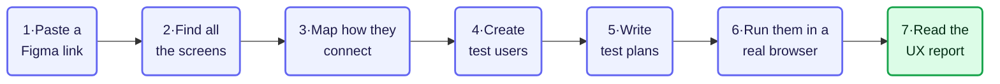
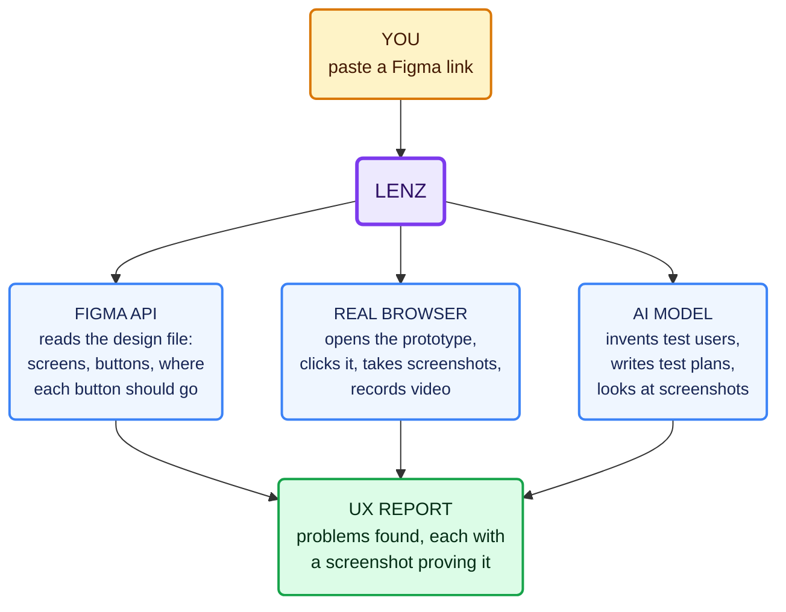
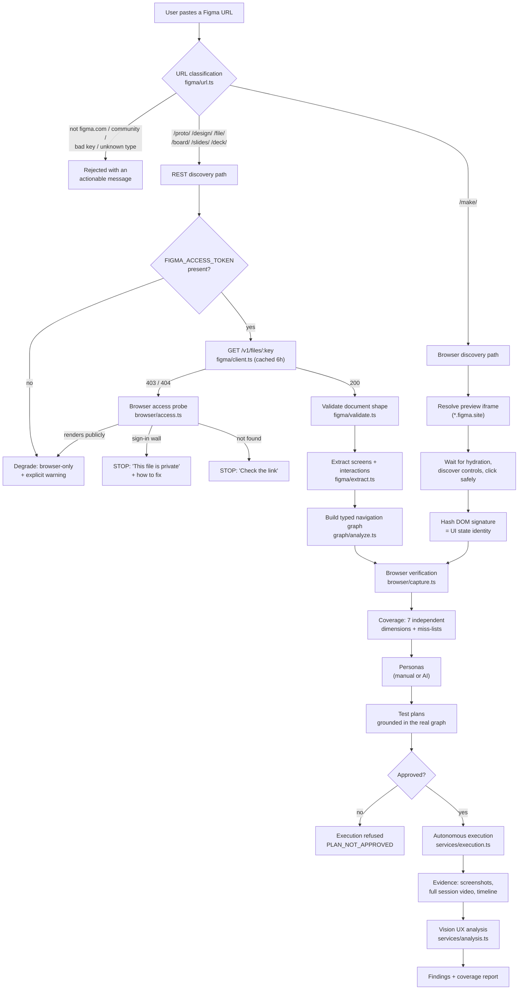
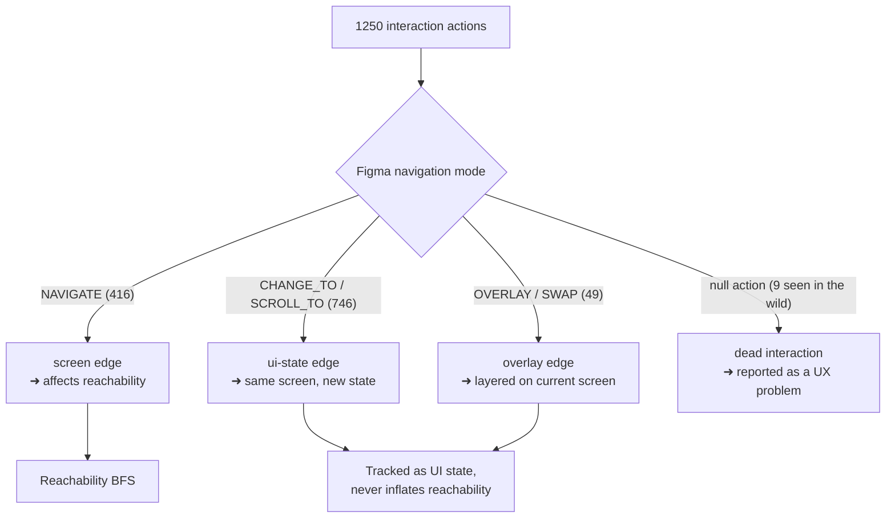
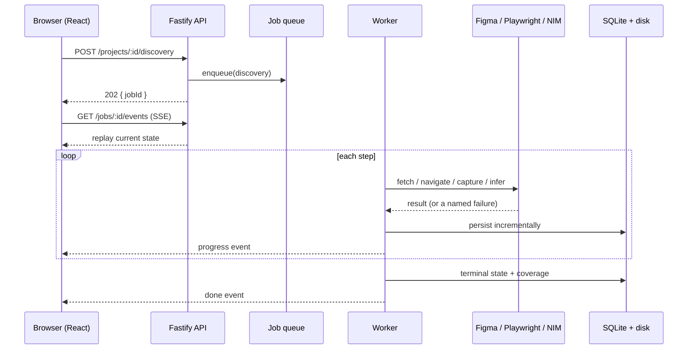
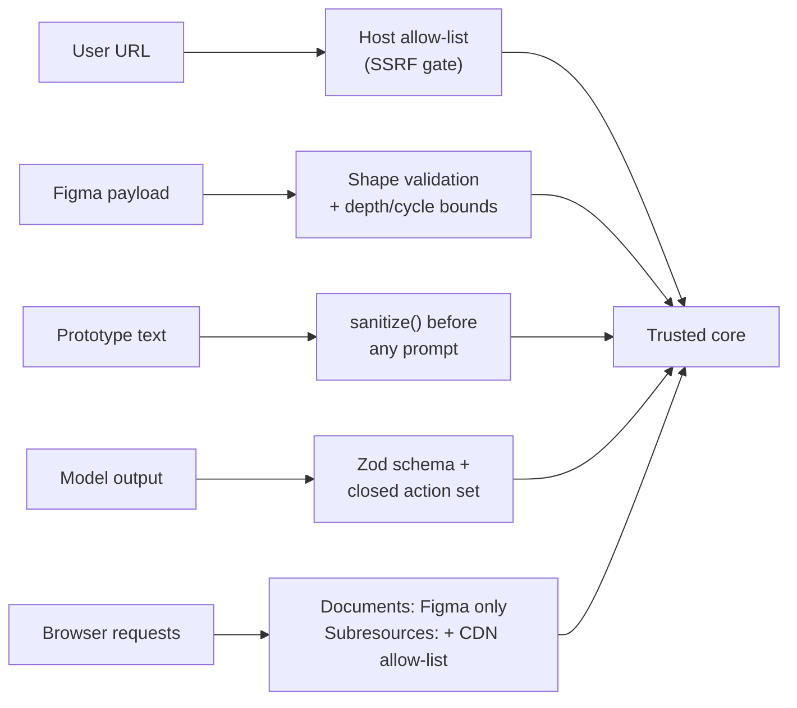

# How Lenz Works

Start here. This page explains the whole system in plain language, with simple pictures.
Technical detail comes later — skip to [Part 2](#part-2--technical-detail) only if you need it.

---

## Part 1 — The simple version

### In one sentence

> You paste a Figma link. Lenz pretends to be a user, clicks through your prototype in a real
> browser, and tells you where that user got stuck — with screenshots proving it.

### The seven steps



| Step | What happens | In plain words |
|---|---|---|
| **1** | Paste a Figma link | Lenz checks the link is one it can open, and tells you what it will be able to do with it |
| **2** | Find all the screens | Reads your design file and works out which frames are real screens and which are just buttons and icons |
| **3** | Map how they connect | Works out which button leads to which screen — the "map" of your prototype |
| **4** | Create test users | Invents realistic people: a confident shopper, a hesitant first-timer, someone with low tech confidence |
| **5** | Write test plans | For each person, writes a task to attempt — "find a dress and add it to the cart" — using only screens that really exist |
| **6** | Run them in a real browser | Actually opens your prototype and clicks through it, taking screenshots and recording video |
| **7** | Read the UX report | Lists the problems it hit, each linked to the screenshot that proves it |

### Who does the actual work

Lenz itself is the coordinator. Three outside systems do the heavy lifting:



| System | Its job | Why it is needed |
|---|---|---|
| **Figma API** | Reads the design file | Tells us what *should* happen when a button is clicked |
| **Real browser** (Playwright) | Drives the prototype | Tells us what *actually* happens |
| **AI model** (NVIDIA NIM) | Thinks like a user | Invents people, writes tasks, and looks at screenshots to spot problems |

**The key trick:** Figma says what *should* happen. The browser shows what *does* happen.
When those two disagree, that disagreement **is** the bug.

### A real example

This is an actual run against a real e-commerce prototype:

```
1.  Pasted the Figma link
2.  Found 53 screens  (and correctly ignored 63 buttons/icons that aren't screens)
3.  Mapped 416 real screen-to-screen links
4.  Created "Maya Tran" — a confident online shopper
5.  Wrote her a task: "find a linen dress and add it to the cart"
6.  Ran it in a browser: 6 actions, 59 seconds of video

7.  REPORT:
    CRITICAL  Clicking the Shopping Bag does nothing — Maya cannot reach her cart
    HIGH      Prices shown in "Rs" but Maya's budget is in "£" — she can't compare
    MEDIUM    The dress she picked is polyester, not the linen she wanted
```

Those last two came from the AI **reading the screenshots** — it saw "Rs. 2,000" on the page
and "Fabric: Recycled polyester" on the product page. The first came from the browser
genuinely clicking and genuinely going nowhere.

### What makes it trustworthy

| Principle | What it means for you |
|---|---|
| **Every finding has evidence** | If there's no screenshot, it can't be labelled "observed" |
| **It admits what it missed** | "31 of 53 screens reachable" — and *why* each of the other 22 wasn't |
| **No made-up score** | No "UX score: 72/100". A score needs a proven method; we don't have one, so we don't invent one |
| **It won't run without your OK** | Test plans must be approved before anything executes |

---

## Part 2 — Technical detail

Everything below is for people working on the code.

### The full flow, including failures



### Stage by stage

| # | Stage | Module | Tool | Output |
|---|---|---|---|---|
| 1 | URL classification | `figma/url.ts` | Pure TS + WHATWG `URL` | Link kind, file key, start node, support level. Also the **SSRF gate** |
| 2 | Access check (on REST failure) | `browser/access.ts` | Playwright (anonymous) | `public-renders` / `requires-sign-in` / `not-found` |
| 3 | REST discovery | `figma/client.ts` | Figma `GET /v1/files/:key` | Full document (~8.7 MB), cached 6 h |
| 4 | Payload validation | `figma/validate.ts` | Pure TS guards | Usable canvases, or a readable error |
| 5 | Extraction | `figma/extract.ts` | Bounded tree walk | Screens, typed edges, flows, dead interactions |
| 6 | Classification | `figma/classify.ts` | Weighted scoring | `screen` / `component` / `ambiguous` + reasons |
| 7 | Graph analysis | `graph/analyze.ts` | BFS, connected components | Reachability, flows, paths, entry-point ranking |
| 8 | Browser verification | `browser/capture.ts` | Playwright Chromium | Validated screenshots + URL-verified destinations |
| 9 | Make discovery | `services/make-discovery.ts` | Playwright + DOM hashing | Browser-discovered UI states |
| 10 | Coverage | `services/coverage.ts` | Pure TS | 7 dimensions, each with a miss-list |
| 11 | Personas | `services/personas.ts` | NVIDIA NIM | Structured, Zod-validated personas |
| 12 | Test plans | `services/testplans.ts` | NIM + real graph context | Plans with graph-validated node ids |
| 13 | Execution | `services/execution.ts` | Playwright + NIM vision | Timeline, screenshots, video |
| 14 | UX analysis | `services/analysis.ts` | NIM vision | Evidence-linked findings |
| 15 | Delivery | `routes/*`, React | Fastify + SSE, React/Vite | Dashboard, recap player, report |

**Infrastructure:** Fastify 5 · SQLite (`better-sqlite3`) · local disk behind `EvidenceStorage`
· in-process job queue · Server-Sent Events · Zod 4 · Playwright · React 18 + Vite 6 +
Tailwind + TanStack Query · Vitest (122 tests).

### Why edges are typed

Measured on the reference file: **1250 interactions, but only 416 are screen transitions.**



Treating all 1250 as navigation would be wrong **59% of the time** and would roughly double
the reported screen count. (ADR-0001)

### Long-running work



Cancellable between steps · partial results persist as they are proven · SSE replays state so
a reconnecting client is immediately consistent.

### Where untrusted input is stopped



The model may propose only `click`, `clickElement`, `navigateToNode`, `scroll`, `type`,
`wait`, `back`, `done`. Raw JavaScript and arbitrary URLs are **not representable** in the
action type — unsafe actions are impossible, not merely discouraged.

### Honest reporting, enforced in code

1. A coverage dimension reaches 100% **only** when its miss-list is empty. Seven dimensions
   tracked separately; no combined score, because averaging hides gaps.
2. A finding is `observed` **only** if it links to a validated screenshot; otherwise it is
   downgraded to `potential`.

Real output from the reference run:

```
designDiscovery        48/53  90.6%   misses=5    (63 components excluded by design)
reachability           31/53  58.5%   misses=22   each with a machine-readable reason
interactionDiscovery 1190/1250 95.2%  misses=21
screenshotCapture        5/5   100%   note: "47 screen(s) were not attempted in this run"
```

---

## Related documents

| Document | Purpose |
|---|---|
| [`../HANDOVER.md`](../HANDOVER.md) | New session? Orientation, gotchas, working agreements |
| [`../findings/external-verification.md`](../findings/external-verification.md) | What was **measured** about Figma, NIM and Playwright |
| [`../architecture/overview.md`](../architecture/overview.md) | Module boundaries and technology choices |
| [`../architecture/failure-modes.md`](../architecture/failure-modes.md) | Every failure class and its handling |
| [`../decisions/README.md`](../decisions/README.md) | Architecture Decision Records |
| [`../development/status.md`](../development/status.md) | Honest current state and gaps |
